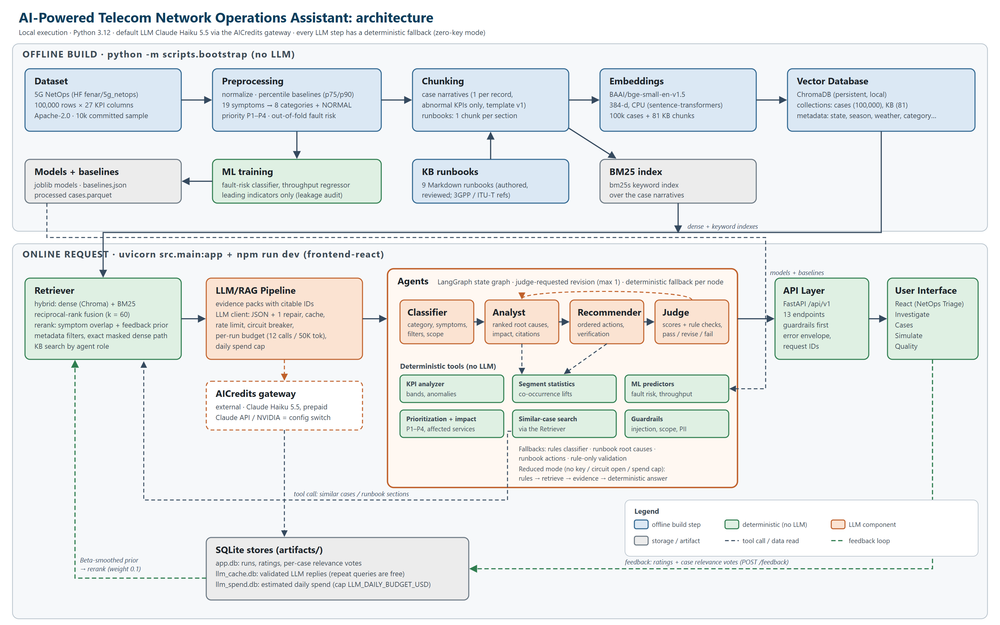

# AI-Powered Telecom Network Operations Assistant

A local assistant for a mobile-network operations centre (NOC). An engineer describes an incident in plain language, for example *"A cell is experiencing high latency, packet loss, and reduced throughput"*. The assistant then:

- **retrieves similar historical incidents** from 100,000 records (hybrid semantic + keyword search with filters);
- **classifies the incident** and assesses its KPIs against the network's own history;
- **predicts fault risk** and expected throughput with trained ML models;
- **explains likely root causes and recommends ordered troubleshooting steps**, grounded in cited runbooks and cases, through a multi-agent workflow with an LLM judge that checks the answer;
- **prioritizes** the incident (P1–P4) and estimates its impact;
- **learns from feedback**: engineer votes on case relevance re-rank future searches.

Every LLM step has a deterministic fallback, so the app also runs with **no API key** (reduced mode).



## 1. Overview

**Problem.** NOC engineers triage KPI degradations under time pressure. Past incidents and runbook knowledge exist, but finding the relevant ones, and turning them into a prioritized, verifiable action plan, is slow and depends on individual experience.

**Objective.** Shorten triage: from a free-text description (and optional KPI values), return similar past cases, a classified and prioritized incident, a root-cause analysis and actionable steps, each tied to its evidence.

**Features mapped to the PRD**

| PRD requirement | What the app does | Where |
|---|---|---|
| R1 Similar-incident retrieval | Hybrid dense + BM25 search, reciprocal-rank fusion, symptom and feedback rerank, metadata filters (state, city, season, weather, category) | `/search`, Cases page |
| R1 Incident understanding | LLM classifier (8 incident types + NORMAL) with a rule-based fallback; KPI assessment against network baselines | `/classify`, `/troubleshoot` |
| R2 Root cause and recommendations | Multi-agent graph: classifier → analyst → recommender → judge (one revision loop); runbook-grounded, cited actions with phase, verification and change-approval flags | `/troubleshoot`, Investigate page |
| R2 Basic RAG baseline | Single-call answer for comparison | `/recommend` |
| Prediction | Fault-risk classifier and throughput regressor (scikit-learn), with top drivers | `/predict/fault-risk`, `/predict/performance`, Simulate page |
| Prioritization | Deterministic P1–P4 score from severity, impact and risk, with reasons | `/prioritize` |
| Feedback loop | Ratings and per-case relevance votes; Beta-smoothed rerank prior; summary dashboard | `/feedback`, `/feedback/summary`, Quality page |
| Guardrails | Prompt-injection, off-topic, gibberish and length checks; PII redaction | every text endpoint |

## 2. Technology stack

| Layer | Choice |
|---|---|
| Language | Python 3.12 |
| LLM | **Claude Haiku 5.5** for all agents through the **AICredits** gateway (OpenAI-compatible, prepaid) by default; the direct Claude API (any Claude model) and the NVIDIA API catalog are config switches. Zero-key reduced mode. |
| Embeddings | `BAAI/bge-small-en-v1.5` (sentence-transformers, CPU) |
| Retrieval | ChromaDB (dense) + bm25s (keyword), reciprocal-rank fusion and rerank |
| Agents | LangGraph state graph |
| ML | scikit-learn (HistGradientBoosting) |
| API | FastAPI + Uvicorn |
| Frontend | React 19 + TypeScript (Vite, TanStack Query), `frontend-react/` |
| Evaluation | DeepEval (LLM judge), plus custom retrieval, classifier, guardrail, ML and judge meta-evaluations |
| Storage | SQLite (runs, feedback, LLM response cache, spend ledger) |

## 3. Repository structure

```
architecture/          Architecture diagram (PDF, PNG, SVG source) and the agent graph (Mermaid)
data/                  raw/ (full dataset, downloaded), sample_data/ (10k committed sample), knowledge_base/ (9 runbooks)
design/                Design document (PDF + Markdown source)
docs/                  API documentation, dataset details, evaluation report (PDFs + Markdown sources in docs/source/),
                       Architecture_Overview_React.md (presenter notes with diagrams)
evaluation/            Evaluation scripts; results/final/ (Sonnet 5.5 run), results/runs/ (demo-setup run, baselines, test runs)
frontend-react/        NetOps Triage, the React frontend (Vite + React + TypeScript); talks to the API over HTTP only
presentation/          Project presentation (PPTX)
scripts/               bootstrap, data download, sampling, environment checks, API example capture, spend report
src/
  main.py              FastAPI app (uvicorn src.main:app)
  api/                 routes, request/response schemas, error envelope
  agents/              classifier, analyst, recommender, judge, LangGraph graph, prompts/
  rag/                 preprocessing, documents, chunking, embeddings, vector store, hybrid retriever, context builder
  services/            LLM client, troubleshooting service, KPI analyzer, prioritization, ML, guardrails, feedback
  utils/               settings (.env), schema and taxonomy
tests/                 pytest suite; test_cases/ holds every test and evaluation dataset
artifacts/             generated: indexes, models, baselines, SQLite files (not committed)
```

## 4. Installation (Windows, PowerShell)

Prerequisites: Python 3.12, about 3 GB of free disk, internet access for the first model download.

```powershell
py -3.12 -m venv .venv
.venv\Scripts\Activate.ps1          # if blocked: Set-ExecutionPolicy -Scope CurrentUser RemoteSigned
pip install -r requirements.txt
pip install --no-deps -r requirements-deepeval.txt
```

The second command installs DeepEval 2.9.3 without dependency resolution. DeepEval declares `anthropic<0.50`, while the app uses `anthropic==1.12.1`, so pip cannot install both in one step; DeepEval only imports two class names from `anthropic`, which 1.x still provides, and its other dependencies are pinned in `requirements.txt`. Afterwards `pip check` reports this one known, harmless conflict.

## 5. API key configuration

```powershell
copy .env.example .env               # then edit .env
```

| Setting | Purpose | Where to get it |
|---|---|---|
| `AICREDITS_API_KEY` | Default provider (`LLM_PROVIDER=aicredits`): Claude Haiku 5.5 for the agents and `openai/gpt-oss-120b` as the evaluation judge, through the OpenAI-compatible AICredits gateway (prepaid INR credits) | aicredits.in |
| `ANTHROPIC_API_KEY` + `LLM_PROVIDER=anthropic` | Claude direct from Anthropic; model `ANTHROPIC_MODEL`, default `claude-haiku-5-5` | console.anthropic.com → API keys |
| `LLM_DAILY_BUDGET_USD` | Daily cap on estimated API spend, default `1.00` | — |
| `NVIDIA_API_KEY` + `LLM_PROVIDER=openai_compatible` | Optional rollback to the NVIDIA API catalog | build.nvidia.com |
| `LLM_PROVIDER=none` | **Zero-key mode**: no LLM calls; rule-based classification, runbook actions, rule checks | — |

**Never commit `.env`** (it is in `.gitignore`).

**Cost control.**
- *Per query:* one `/troubleshoot` query on Claude Haiku 5.5 costs about **$0.007** direct, or about **₹0.75** through AICredits (token counts measured on 11 queries, 2026-10-09). `/recommend` costs about a tenth of that.
- *Repeated queries are free:* replies are cached in `artifacts/llm_cache.db`, so an identical query costs nothing.
- *Daily cap:* once `LLM_DAILY_BUDGET_USD` is reached, the app switches to reduced mode until the next UTC day.
- *Check today's spend* (no API call): `python -m scripts.spend_report`. The Console's bill is authoritative.

## 6. Build the data artifacts

```powershell
python -m scripts.bootstrap --source sample   # committed 10k sample: 18 min measured on a laptop CPU (17 min embedding)
python -m scripts.bootstrap --source full     # downloads the 100k dataset; embedding took 95 min on the same CPU (2026-10-07)
```

Steps: preprocess and label → train ML models → prioritize → embed and index cases (Chroma + BM25) → index the knowledge base. No LLM is used. Verified from a clean folder on 2026-10-09: after the sample build, the app starts ready (9,996 cases, 81 runbook chunks) and answers in zero-key mode. To build into another folder without touching `artifacts/`, set `ARTIFACTS_DIR`; ML metrics from sample or scratch builds go to `<ARTIFACTS_DIR>/ml_results/`, never to the published `evaluation/results/final/ml/`.

## 7. Run locally (two terminals, from the repository root)

Node.js 20 or newer is needed for the frontend.

```powershell
uvicorn src.main:app --reload --reload-dir src      # terminal 1: API on port 8000
cd frontend-react; npm install; npm run dev         # terminal 2: UI on port 5173
```

- UI: http://localhost:5173 (the dev server forwards `/api` to `http://localhost:8000`; set `VITE_API_TARGET` to change it)
- API docs (Swagger): http://localhost:8000/docs

The UI has four areas: **Investigate** (describe an incident, watch the agents work live, read a summary-first report), **Cases** (similar-case search), **Simulate** (what-if KPIs, fault risk, throughput) and **Quality** (judge verdicts, feedback and both saved evaluation runs).

- Light and dark themes; **Demo mode** (rail switch) enlarges type and turns the five sample incidents into cards you run with keys 1 to 5.
- `npm test` runs the unit tests; `npm run build` writes a static build to `frontend-react/dist/` (`npm run preview` serves it with the same proxy).
- How the system works, for presenting it: `docs/Architecture_Overview_React.md`.

## 8. Sample queries and real outputs

The outputs below come from the recorded Claude Haiku 5.5 run of 2026-10-09 (`evaluation/results/runs/haiku_runtime_test/`). LLM wording varies between runs; the structured fields are stable and are checked in `tests/test_cases/sample_queries.json`.

| PRD query | Category | Priority | Fault risk | Verdict | Latency |
|---|---|---|---|---|---|
| "A cell is experiencing high latency, packet loss, and reduced throughput. What similar network conditions have occurred before?" | TRANSPORT_QOS | P4 Low | Low (0.04) | pass | 32 s |
| "Multiple cells are experiencing poor service quality and increasing alarm counts. What factors could be contributing to the problem?" | FAULT_ALARM | P3 Medium | Low (0.23) | pass after 1 revision | 68 s |
| "A network region has increasing fault occurrence and declining handover success. What corrective actions should be considered?" | FAULT_ALARM | P3 Medium | High (0.77) | pass after 1 revision | 62 s |

**First three recommended actions for PRD query 1:**
1. *(immediate)* Run latency, jitter and packet loss measurements (e.g. TWAMP or a ping series) from the site to the core and compare against baseline.
2. *(immediate)* Check interface counters on the site router and aggregation devices for errors, discards and CRC failures.
3. *(immediate)* Check backhaul utilization and received signal or optical power levels on the transport link during the affected period.

The top hypothesis was transport or backhaul congestion, or an under-dimensioned transport link, causing queuing and loss on the path to the cell.

Two more demo queries with expected structured fields are in `tests/test_cases/sample_queries.json`.

**curl examples** (the full captured request/response pairs are in `tests/test_cases/api_examples.json`):

```bash
curl http://localhost:8000/api/v1/health
curl -X POST http://localhost:8000/api/v1/search -H "Content-Type: application/json" \
     -d '{"query": "High latency and packet loss on video calls in winter", "filters": {"season": ["Winter"]}, "top_k": 3}'
curl -X POST http://localhost:8000/api/v1/prioritize -H "Content-Type: application/json" \
     -d '{"kpis": {"latency_ms": 150, "packet_loss_pct": 14, "alarm_count": 16, "user_count": 9500, "weather": "Snow"}}'
curl -X POST http://localhost:8000/api/v1/troubleshoot -H "Content-Type: application/json" \
     -d '{"query": "A cell is experiencing high latency, packet loss, and reduced throughput."}'
```

The last call above (`/troubleshoot`) uses the LLM, about ₹0.75 (≈ $0.007) per uncached query; the other three never call an LLM.

## 9. Testing and evaluation

```powershell
pytest                                        # unit, API and graph tests; no API calls (fake LLM)
python -m evaluation.run_all --suite quick    # retrieval, components, guardrails, feedback simulation: no LLM, free
python -m evaluation.run_all --suite all      # adds classification, end-to-end runs, DeepEval, judge meta-evaluation (uses the API)
```

The suite has been run on two configurations, both shown on the Quality page:
- **Claude Sonnet 5.5 agents, Claude Opus 5.5 judge** (best capability, about $11.4): `evaluation/results/final/`.
- **Claude Haiku 5.5 via AICredits, gpt-oss-120b judge** (the demo setup, about $0.27): `evaluation/results/runs/aicredits_haiku_demo/`, run with `python -m evaluation.run_variant --out <folder>`, which never writes into `final/`.

A general summary of both is in `docs/Evaluation_Report.pdf`.

## 10. Deliverables

| Deliverable | File |
|---|---|
| Architecture diagram | `architecture/Architecture_Diagram.pdf` |
| Design document | `design/Design_Document.pdf` |
| API documentation | `docs/API_Documentation.pdf` |
| Dataset details | `docs/Dataset_Details.pdf` |
| Evaluation report | `docs/Evaluation_Report.pdf` |
| Presentation | `presentation/Project_Presentation.pptx` |

## 11. Limitations

- **Synthetic dataset.** The data shows generator patterns (Faker-style city names, mostly uniform distributions), and has no timestamps, cell IDs or topology. Trends ("increasing", "declining") cannot be verified, and the app says so.
- **Relative severity.** "Degraded" and "critical" mean worse than the 75th and 90th percentile of this network's history, not absolute 3GPP thresholds.
- **Correlation is not causation.** Contributing factors come from co-occurrence statistics in past cases.
- **The runbooks are authored for this project.** They were drafted with LLM help and reviewed; they are not an operator's validated procedures (`data/knowledge_base/README.md`).
- **Haiku 5.5 trades consistency for cost.** In the demo-setup evaluation, 3 of 11 diagnoses needed a judge revision and 2 ended low-confidence, which the app flags. Sonnet 5.5 passed all 11 first time but costs about 10× more per query.
- **Small evaluation samples, single labeller.** LLM judges differ: the two evaluation runs used different judges, so their answer-quality scores are compared within a run.
- **No authentication.** Local use only.

## 12. Team

| Name | Role | Contact |
|---|---|---|
| *(your name)* | *(role)* | *(email)* |

## 13. License and attribution

- **Dataset:** [5G Network Operations (NetOps) Dataset](https://huggingface.co/datasets/fenar/5g_netops), Apache-2.0. The 10k sample in `data/sample_data/` is derived from it (`data/sample_data/README.md`).
- **Knowledge base:** project-authored runbooks citing public standards (3GPP TS 32.450 / TS 28.554, ITU-T Y.1541); see `data/knowledge_base/README.md`.
- **Project code:** *(add a license before publishing)*.
