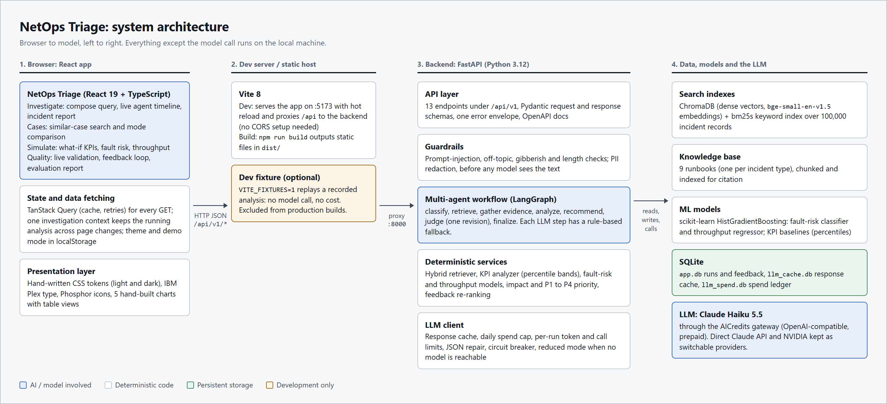
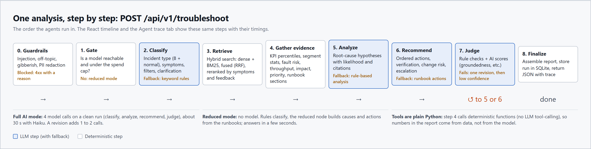
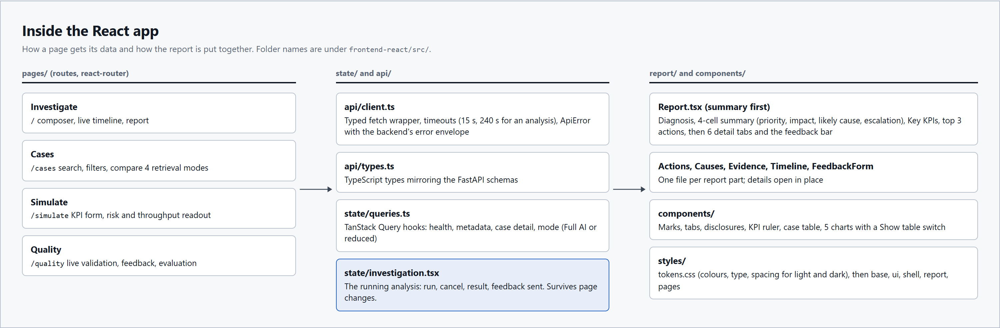

# Architecture overview: NetOps Triage (React frontend)

How the system works end to end, with the React app as the only frontend. It is written as presenter notes: what each part does, how to explain it, the technology behind it, why it was chosen, and what could replace it.

The full one-page architecture diagram, including the offline build, is `architecture/Architecture_Diagram.pdf` (PNG: `architecture/architecture.png`); the agent graph is `architecture/agent_graph.mmd`.

Diagrams in this document: `docs/assets/architecture/` (`system_architecture.png`, `troubleshoot_flow.png`, `react_app_structure.png`).

---

## 1. The 30-second explanation

> A NOC engineer types an incident in plain language, for example "a cell has high latency, packet loss and low throughput". The React app sends it to a FastAPI backend. The backend checks the input, finds the most similar of 100,000 historical incidents, measures how bad each KPI is against the network's own history, and runs four AI agents: one classifies the incident, one explains likely causes, one writes ordered actions, and one judges the answer and asks for a revision if it is not grounded. Every number in the report comes from data or trained models, not from the AI. If the AI is unavailable, every agent has a rule-based fallback, so the app still answers. The React app shows the agents working live and then a report that leads with the diagnosis, priority, likely cause, escalation and the next three actions.

Three points worth stressing:
1. **Grounded:** the AI writes words; data and models produce the numbers. Causes and actions cite runbook sections and cases.
2. **Checked:** a judge agent scores every answer, and rule checks remove invented citations.
3. **Never stuck:** a rule-based fallback for every AI step, a reduced mode with no model at all, and hard cost limits.

---

## 2. System architecture

Read it left to right: browser, dev server, backend, then data and the model.

| Layer | What it does | How to explain it |
|---|---|---|
| **1. React app** (browser) | Four areas: Investigate, Cases, Simulate, Quality. Calls the backend over HTTP JSON only, so it has no Python or model code. | "The frontend is a thin client. It only displays what the API returns, so any other UI could use the same backend." |
| **2. Vite** (dev server, build tool) | During development it serves the app on port 5173 and forwards `/api` calls to the backend on 8000. `npm run build` produces static files. | "In production this would be static files behind any web server; there is no Node server at runtime." |
| **3. FastAPI backend** | 13 endpoints under `/api/v1`, guardrails, the LangGraph multi-agent workflow, deterministic services and the LLM client. | "All intelligence and all safety checks live here, in one place." |
| **4. Data, models, LLM** | Search indexes (ChromaDB + BM25), 9 runbooks, two scikit-learn models and KPI baselines, SQLite files, and Claude Haiku 5.5 through the AICredits gateway. | "Everything runs locally except the single model call per agent." |

### The 13 API endpoints, and which React area uses each

| Endpoint | Purpose | Used by |
|---|---|---|
| `GET /health` | Liveness and component status (index, models, LLM) | Rail mode status, every page's guard |
| `GET /metadata` | Filter vocabularies, incident types, KPI specs and baselines | All forms, KPI rulers |
| `POST /troubleshoot` | The full multi-agent analysis | Investigate |
| `POST /search` | Hybrid similar-case search (no LLM) | Cases |
| `GET /cases/{id}` | One historical case with its KPI assessment | Expanded case rows |
| `POST /predict/fault-risk`, `POST /predict/performance` | ML predictions | Simulate |
| `POST /prioritize` | P1 to P4 priority with reasons | Simulate |
| `POST /classify` | Classifier on its own | API only (used inside `/troubleshoot`) |
| `POST /recommend` | Basic single-call RAG, the evaluation baseline | API only (evaluation "system A") |
| `POST /feedback`, `GET /feedback/summary` | Ratings and case-relevance votes; the feedback dashboard | Investigate feedback bar, Quality |
| `GET /evaluation/latest` | Saved offline evaluation and live validation stats | Quality |

---

## 3. One analysis, step by step

What happens after the engineer clicks **Run analysis**:

| Step | What happens | AI? | If it fails |
|---|---|---|---|
| 0. Guardrails | Blocks prompt injection, off-topic and gibberish text; redacts personal data | No | Request rejected with a 400 and a reason; no model is called |
| 1. Gate | Checks that a model is configured, reachable and under the daily spend cap | No | Whole run switches to reduced mode |
| 2. Classify | Incident type (8 types + normal), symptoms, location and time filters, or a clarifying question | Yes | Keyword rules |
| 3. Retrieve | Hybrid search over 100,000 records: dense vectors + BM25 keywords, fused with reciprocal-rank fusion, reranked by symptom overlap and engineer feedback | No | n/a |
| 4. Gather evidence | KPI percentiles against the network's history, segment statistics, fault-risk and throughput predictions, impact, priority, runbook sections | No (plain Python functions) | n/a |
| 5. Analyze | Root-cause hypotheses with likelihood, evidence and citations | Yes | Rule-based analysis |
| 6. Recommend | Ordered actions (immediate, short-term, preventive) with verification, change risk and escalation | Yes | Actions taken straight from the runbook |
| 7. Judge | Deterministic rule checks (for example, are cited IDs real) plus AI scores such as groundedness. Can send the run back to step 5 or 6 once | Yes | After one revision, the report is marked "Low confidence" |
| 8. Finalize | Assembles the report, stores the run in SQLite, returns JSON with a step-by-step trace | No | n/a |

**What the React app shows while this runs:** a live timeline of these steps with expected durations. After the run, the report leads with a summary and keeps the detail in tabs. The Agent trace tab shows the real timings as a waterfall chart.

**Typical numbers:** 4 model calls on a clean run, about 30 to 40 seconds with Haiku 5.5. A judge revision adds 1 to 2 calls. With AICredits pricing, a new analysis costs about ₹0.75. Repeating the same question is served from the response cache at no cost.

**Reduced mode** (no model, or the cap is reached): rules classify, and a reduced node builds causes and actions from the runbooks. Answers arrive in a few seconds, and the report says clearly that AI was not used.

---

## 4. Inside the React app

| Folder (`frontend-react/src/`) | Role |
|---|---|
| `pages/` | The four routes: Investigate (`/`), Cases, Simulate, Quality |
| `api/` | `client.ts` (typed fetch, timeouts of 15 s and 240 s for an analysis, error envelope), `types.ts` (mirrors the FastAPI schemas), `troubleshoot.ts` (live call or dev fixture) |
| `state/` | `queries.ts` (TanStack Query hooks), `investigation.tsx` (the running analysis survives page changes), `prefs.tsx` (theme, demo mode) |
| `report/` | `Report.tsx` and its parts: Actions, Causes, Evidence panels, Timeline, FeedbackForm, Composer |
| `components/` | Shared UI: severity marks, tabs, disclosures, the KPI ruler, the case table, the five charts |
| `styles/` | `tokens.css` holds every colour, type size and spacing value for light and dark; then base, ui, shell, report and pages |
| `dev/` | The recorded analysis replayed when `VITE_FIXTURES=1` (never in a production build) |

**How the report reduces reading** (design decisions you can point to):
- Summary first: diagnosis, then four cells (priority and severity, impact, likely cause, escalation), the four worst KPIs, and the next three actions. This is the 15 to 30 second read.
- Everything else is one click away in six tabs: Causes, KPIs, Similar cases, Validation, Data and sources, Agent trace.
- Each fact appears once. For example, the Measured or Estimated tag appears once, and case lists appear only under Similar cases.
- Five charts, each with a "Show table" switch so the exact numbers are always available: KPI percentile strip, throughput expected vs observed, agent trace waterfall, judge scores vs pass marks, and basic RAG vs multi-agent.
- Severity is never shown by colour alone: always a square plus a word.

**Demo mode:** a rail switch that enlarges type, shows five preset incidents, and runs them with keys 1 to 5.

---

## 5. Why it is trustworthy and affordable

| Concern | Mechanism | Where |
|---|---|---|
| The AI inventing numbers | Numbers come only from data and models (step 4); agents receive them as evidence | `src/agents/tools.py` |
| The AI inventing sources | Rule checks remove citations that are not in the evidence; the judge marks affected claims as weak | `src/agents/judge_agent.py` |
| A wrong or weak answer | Judge agent with pass marks (groundedness 0.70, others 0.60), one revision, then "Low confidence" shown in the UI | LangGraph `judge` node |
| Model outage or no key | Rule-based fallback per step; whole-run reduced mode | `src/agents/graph.py` |
| Unsafe input | Guardrails before any model call; PII redaction | `src/services/guardrails.py` |
| Cost | Response cache, daily spend cap ($1 by default), per-run limits (50K tokens, 12 calls), prepaid AICredits balance as a hard ceiling | `src/services/llm_client.py` |
| Learning from engineers | Case-relevance votes become a Beta-smoothed prior that reranks future searches | `src/services/feedback_service.py` |

---

## 6. Technology: what we used, why, and alternatives

### Frontend

| Area | Used | Why here | Alternatives |
|---|---|---|---|
| UI framework | **React 19** | Largest ecosystem, component model fits a report built from reusable parts, easy to hire for and explain | Vue, Svelte/SvelteKit, Angular, SolidJS |
| Language | **TypeScript 6** | API response types mirror the backend schemas, so a renamed field fails at build time, not in a demo | Plain JavaScript (faster to start, less safe) |
| Build tool / dev server | **Vite 8** | Instant dev start, hot reload, built-in proxy to the API, small static build | Next.js (adds server rendering we do not need), Create React App (deprecated), webpack, Parcel |
| Routing | **react-router-dom 7** | Standard client-side routing for four pages | TanStack Router, Next.js file routing |
| Server state | **TanStack Query 5** | Caching, retries and loading/error states for every GET without hand-written code | SWR, Redux Toolkit Query, plain `fetch` + `useEffect` |
| App state | **React context** | Only one piece of shared state (the running analysis); a store library would be overkill | Zustand, Redux, Jotai |
| Styling | **Hand-written CSS with design tokens** | Full control of a restrained "incident report" look, light and dark from one token file, no class-name clutter | Tailwind CSS, CSS Modules, styled-components, a component kit (MUI, Chakra, Mantine, shadcn/ui) |
| Charts | **Hand-built HTML/CSS** (5 charts) | Small, on-palette, accessible, each with a table view; no 100 KB+ chart library | Recharts, Chart.js, ECharts, Visx, D3 |
| Icons | **Phosphor Icons** | One consistent, neutral icon family | Lucide, Heroicons, Material Symbols |
| Fonts | **IBM Plex Sans and Mono** (self-hosted via @fontsource) | Technical, highly legible, with tabular figures for numbers; no external font requests | Inter, Source Sans 3, system fonts |
| Tests | **Vitest + jsdom** | Same config as Vite, fast unit tests for the report logic | Jest, Playwright or Cypress for end-to-end tests |
| Dev fixture | **Recorded JSON replay** | Build and demo the UI with no model cost | Mock Service Worker (MSW), a stub backend |

### Backend and API

| Area | Used | Why here | Alternatives |
|---|---|---|---|
| Language | **Python 3.12** | The ML, retrieval and LLM libraries are Python-first | Node.js/TypeScript backend (weaker ML ecosystem) |
| Web framework | **FastAPI + Uvicorn** | Async, automatic OpenAPI docs, Pydantic validation of every request and response | Flask, Django REST Framework, Litestar |
| Validation and settings | **Pydantic, pydantic-settings** | One schema definition gives validation, docs and the TypeScript types to copy | marshmallow, attrs |
| Agent orchestration | **LangGraph** | An explicit state graph with conditional edges matches the workflow (judge loop, fallbacks, reduced route), and every node is traced | Plain Python functions, CrewAI, AutoGen, LlamaIndex workflows, Claude Agent SDK |

### AI and retrieval

| Area | Used | Why here | Alternatives |
|---|---|---|---|
| LLM | **Claude Haiku 5.5** via the **AICredits** gateway | Same Claude model at about a tenth of Sonnet's price, prepaid INR credits act as a hard spending cap; providers are switchable in `.env` | Direct Claude API, Claude Sonnet/Opus for higher quality (Sonnet 5.5 is the best measured configuration), NVIDIA-hosted open models (earlier phase), local models through Ollama or vLLM |
| Embeddings | **BAAI/bge-small-en-v1.5** (sentence-transformers, CPU) | Strong quality for its size, runs on a laptop CPU, free | bge-base/large, e5, OpenAI or Voyage embeddings (paid API) |
| Vector store | **ChromaDB** | Embedded, local, persistent, supports metadata filters | FAISS, Qdrant, pgvector, Weaviate, Pinecone |
| Keyword search | **bm25s** | Fast pure-Python BM25 that catches exact terms (KPI names, IDs) dense search misses | Elasticsearch/OpenSearch, rank-bm25, SQLite FTS5 |
| Fusion and rerank | **Reciprocal-rank fusion + symptom and feedback rerank** | Simple, robust, no extra model; measured nDCG@10 0.953 with the rerank (0.934 fusion alone) vs 0.913 for the best single mode | Cross-encoder reranker (bge-reranker), Cohere Rerank |
| ML models | **scikit-learn HistGradientBoosting** | Strong on tabular KPI data, fast, explainable top drivers | XGBoost, LightGBM, CatBoost, logistic regression |
| Answer evaluation | **DeepEval** + custom suites | Standard RAG metrics (faithfulness, relevancy, contextual precision/recall) plus G-Eval rubrics | RAGAS, TruLens, promptfoo, LangSmith evals |

### Storage and operations

| Area | Used | Why here | Alternatives |
|---|---|---|---|
| Database | **SQLite** (runs and feedback, LLM response cache, spend ledger) | Zero setup, a single file, enough for one team | PostgreSQL, Redis for the cache |
| Configuration | **`.env` files** (gitignored) | Keys never enter the repository; switch provider or model without code changes | A secrets manager (Vault, AWS Secrets Manager) |
| Version control | **Git / GitHub** | Standard | n/a |

---

## 7. Likely questions and short answers

- **Why multiple agents instead of one prompt?** Each agent has one job and its own fallback, and the judge can send back only the part that failed. The evaluation compares the two directly: actionability rises from 0.60 to 0.84 on Sonnet 5.5 and from 0.66 to 0.99 on the Haiku demo setup (each scored by its own judge).
- **How good is it?** Search finds a relevant case in the top 5 for every test query, the classifier is right on 21 of 22, guardrails block 12 of 12 bad inputs with no false positives, and the judge agent catches 12 of 12 planted errors. On the demo setup 27 of 28 targets are met (`docs/Evaluation_Report.pdf`).
- **What if the AI is wrong?** The judge scores every answer. Weak answers are revised once and otherwise shown as "Low confidence". Numbers never come from the AI.
- **What if there is no internet or no key?** Reduced mode: rules and runbooks, answers in seconds, clearly labelled.
- **How does it learn?** Engineers mark similar cases relevant or not, and future searches for the same incident type rerank accordingly.
- **How much does it cost?** About ₹0.75 per new analysis with Haiku through AICredits; repeats are free from the cache. A daily cap and the prepaid balance bound the total.
- **Is it production ready?** It is a local single-team system: SQLite, no authentication, one machine. Production would need auth, PostgreSQL, a hosted vector store, and monitoring.

---

## 8. Where to find things

| Item | Path |
|---|---|
| React app | `frontend-react/` (`npm run dev`, `npm test`, `npm run build`) |
| API entry point | `src/main.py` (`uvicorn src.main:app --port 8000`) |
| Agent graph | `src/agents/graph.py`; original diagram in `architecture/agent_graph.mmd` |
| Agents and prompts | `src/agents/` |
| Retrieval | `src/rag/` |
| Services (KPI, ML, priority, feedback, LLM client) | `src/services/` |
| Evaluation | `evaluation/`; results in `evaluation/results/final/` (Sonnet 5.5) and `evaluation/results/runs/aicredits_haiku_demo/` (demo setup); summary `docs/Evaluation_Report.pdf` |
| One-page architecture diagram | `architecture/` |
